# ha-notify-hub

[](https://www.home-assistant.io/integrations/marketplace/)
[](https://github.com/juju35/ha-notify-hub/actions/workflows/hacs.yml)
[](https://github.com/juju35/ha-notify-hub/actions/workflows/validate.yml)
[](https://github.com/juju35/ha-notify-hub/actions/workflows/lint.yml)
[](https://github.com/juju35/ha-notify-hub/releases/latest)
[](https://github.com/juju35/ha-notify-hub/blob/main/LICENSE)
[](https://buymeacoffee.com/julienstep9)

<p align="center">
  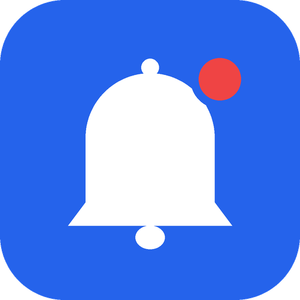
</p>

Home Assistant integration that puts **one hub in front of all your notifications**: your automations call `notify_hub.send` with a priority, and the hub decides who gets it, on which phone, and when — quiet hours, duplicates dropped, low-priority messages grouped in a digest, critical ones escalated until someone acknowledges them. A sidebar **panel** shows the journal and sets the rules; a Lovelace **card** shows what happened today.

[](https://my.home-assistant.io/redirect/marketplace_repository/?owner=juju35&repository=ha-notify-hub&category=integration)

| Card | Waiting for an acknowledgement |
|---|---|
| 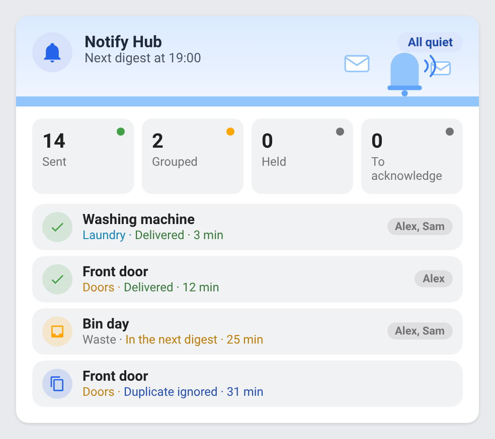 | 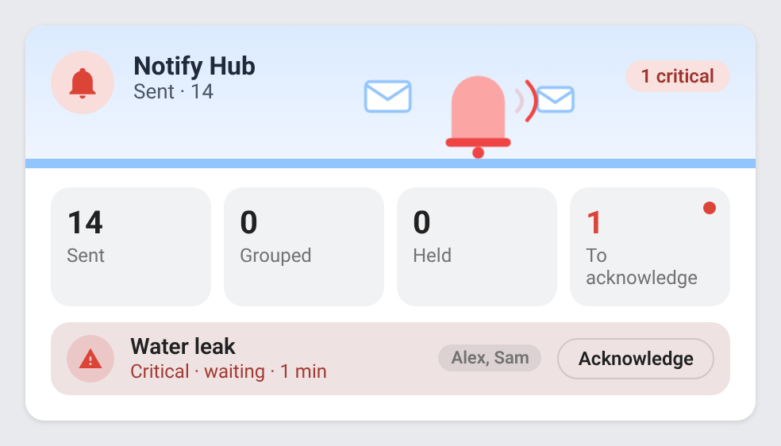 |

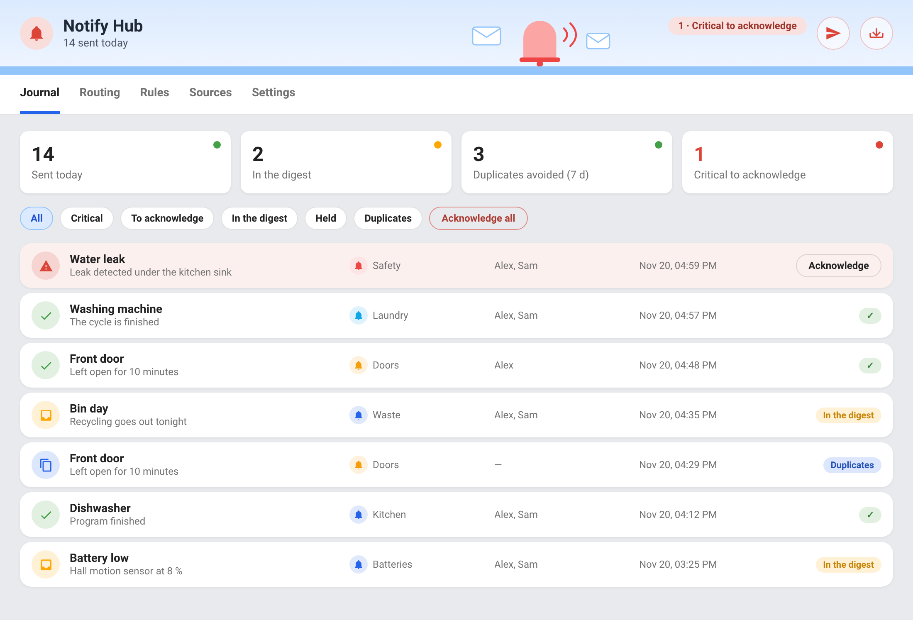

## Features

- **One action for every automation** — `notify_hub.send` with a message, a priority and optionally a topic, a source and the people concerned; no more list of `notify.mobile_app_*` to keep up to date
- **A notify target for every integration** — `notify.notify_hub` (action and entity) can be picked wherever an integration asks for a notify service
- **People, not phones** — each person's phones are found from their `person` entity (Companion app device trackers); override them per person in the panel
- **Four priorities**
  - `critical`: sent at once to everyone concerned, through quiet hours, with the critical sound (iOS) and an **Acknowledge** button
  - `alert`: to the people at home (everyone when nobody is), held during quiet hours
  - `info`: to the people at home, held during quiet hours; with nobody home, kept for the digest — or sent to everyone with the **away mode** on
  - `digest`: always grouped and sent at the digest times
- **Quiet hours** — alert and info notifications are held and delivered when they end
- **Duplicates dropped** — the same topic (or the same title and message) within N minutes is sent once
- **Digests** — one grouped notification at the times you choose (08:00 and 19:00 by default)
- **Escalation** of critical notifications — not acknowledged after 5 min: sent again to everyone; after 10 more: to an SMS service of your choice
- **Sources** — each notification is filed under its integration, found by itself from the automation that sends it (or given as an integration, an entity or a text); per source: name, icon, color, forced priority, people, duplicate delay, quiet hours ignored, or muted
- **Captured notifications** (optional) — Home Assistant's persistent notifications and new repairs go through the hub too, filed under their integration
- **Acknowledge** from the phone notification, the card or the panel: the notification is cleared on every phone
- **Panel** (administrators) — journal with filters (by status or source), people and channels, rules, sources, settings and test buttons; a red badge on the sidebar entry while something waits for an acknowledgement; the top bar can be hidden (Settings tab), the tabs staying with the menu and the buttons
- **Card** — today's figures and the latest notifications, with the Acknowledge button
- Animated illustrated header (bell ringing when something critical waits), light and dark
- **Sensors** — sent today, grouped, held, duplicates avoided, to acknowledge
- Journal kept across restarts (7 days by default)
- 22 languages

## Prerequisites

- Home Assistant 2024.12 or later
- The [Companion app](https://companion.home-assistant.io) on the phones, each linked to a `person`

## Installation

### Via the Marketplace (recommended)

Click the button below to add the repository directly:

[](https://my.home-assistant.io/redirect/marketplace_repository/?owner=juju35&repository=ha-notify-hub&category=integration)

Then click **Install** and restart Home Assistant.

Or manually:

1. Open **Settings → Marketplace → Add from link** (top right; this needs a GitHub account connected)
2. Add `https://github.com/juju35/ha-notify-hub` — Type: **Integration**
3. Open **Notify Hub** and click **Install**
4. Restart Home Assistant

The card is **part of the integration**: at startup it is added to the dashboard resources (`/notify_hub_static/notify-hub-card.js`, module). After an install or an update, restart Home Assistant and refresh the browser (clear the companion app cache if needed).

If your dashboards are in YAML mode, the card is loaded on every page without going through the resources.

### Manual

Copy `custom_components/notify_hub/` to `/config/custom_components/notify_hub/`, then restart Home Assistant.

## Configuration

### Integration

**Settings → Devices & services → Add integration → Notify Hub**. One instance; everything has a default, so there is nothing to fill in. The **Notify Hub** panel appears in the sidebar (administrators); the rules can also be changed from the integration's **Configure** button.

### Sending

```yaml
action: notify_hub.send
data:
  message: "Leak detected under the kitchen sink"
  title: "Water leak"
  priority: critical
  topic: leak_kitchen   # optional: what counts as the same notification for the duplicates
  source: Safety        # optional: an integration (hue), an entity or a text; found from the automation when left out
  people:               # optional: everyone when left out
    - person.alex
  url: /lovelace/home   # optional: opened when the notification is tapped
  data: {}              # optional: extra Companion app data, merged as is
```

The action returns the journal entry (`id`, `status`, `people`, `source`), so a script can wait for the acknowledgement.

### From other integrations: `notify.notify_hub`

Many integrations only ask for a **notify service** to send their alerts to. Pick **`notify.notify_hub`** there: their notifications then go through the hub's rules like any other, filed under the integration that sent them.

```yaml
action: notify.notify_hub
data:
  title: "Low battery"
  message: "Kitchen sensor at 5 %"
  target:               # optional: the people (everyone, by priority and presence, when left out)
    - person.alex
  data:                 # optional: the hub's keys, the rest goes to the phones as is
    priority: alert     # info when left out
    topic: battery_kitchen
    url: /lovelace/home
```

There is also a `notify.notify_hub` **entity**, for the integrations and automations that use `notify.send_message` (message and title only, sent as an info). A source's rules (forced priority, people, muted…) are the simplest way to tune an integration that cannot pass a priority.

> An integration that both posts a persistent notification and calls a notify service would reach the hub twice with the captured notifications on: give it `notify.notify_hub` or rely on the capture, not both.

| Action | What it does |
|---|---|
| `notify_hub.send` | Sends a notification through the hub's rules |
| `notify_hub.acknowledge` | Acknowledges one critical notification (`id`), or every pending one when left out; returns the number acknowledged |
| `notify_hub.send_digest` | Sends the digest now; returns the number of notifications it grouped |

Each notification also fires a `notify_hub_notification` event with its journal entry.

### Sources

Every notification is filed under a **source**, shown in the journal and on the card:

- without `source`: the automation or script that called `notify_hub.send` is found, then the integration most of its entities belong to (helpers, templates and Home Assistant itself left aside) — a leak automation on ZHA sensors is filed under *Zigbee Home Automation*; an automation that only uses helpers is its own source
- `source: hue` (a loaded integration), `source: binary_sensor.kitchen_leak` (its integration) or any text (`source: Safety`)

Each source can be customized in the panel's **Sources** tab — also before its first notification, by picking the integration in the list — or as YAML in **Configure → Sources** (keyed by the integration domain, `automation.<id>` or the slug of the text):

```yaml
hue:
  name: Lights
  icon: mdi:lightbulb      # Android notification icon, journal and card
  color: "#f59e0b"         # Android notification accent, journal and card
  priority: digest         # forced priority (critical, alert, info, digest)
safety:
  priority: critical
  people: [person.alex]    # only these people (default: by priority and presence)
  ignore_quiet: true       # alerts and infos go through the quiet hours
  dedup_minutes: 0         # its own duplicate delay
garden:
  muted: true              # kept in the journal, sent to nobody
```

The same tab (or step) turns on the **captured notifications**: persistent notifications (the sidebar bell, as infos, filed under the integration their id starts with) and new repairs (an alert for an error, an info for a warning, opening Settings → Repairs). Both are off by default.

### Entities

One device, **Notify Hub**, with the `notify.notify_hub` entity and five sensors (named in Home Assistant's language):

| Sensor | What it counts |
|---|---|
| Sent today | Notifications delivered today |
| Waiting for the digest | Grouped for the next digest |
| Held by the quiet hours | Held until the quiet hours end |
| Duplicates avoided | Duplicates dropped over the last 7 days |
| Critical to acknowledge | Critical notifications not acknowledged yet (its attributes carry the card's data) |

### Card

```yaml
type: custom:notify-hub-card
```

Every option is in the visual editor.

| Option | Default | Description |
|---|---|---|
| `title` | `Notify Hub` | Header title |
| `rows` | `4` | Latest notifications shown (1–8) |
| `illustration_theme` | `auto` | Header illustration: `auto` (follows the theme), `day` or `night` |
| `entity` | found | The hub's *Critical to acknowledge* sensor (found by itself) |
| `language` | Home Assistant's | Force another language |

## Screenshots

### Card

| Light | Dark |
|---|---|
|  | 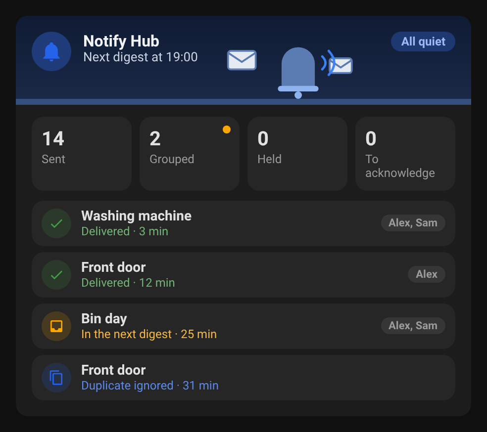 |
| 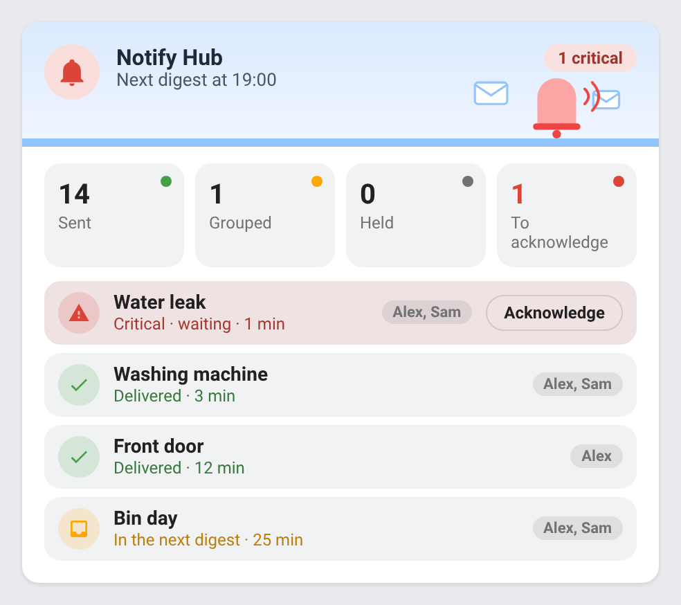 | 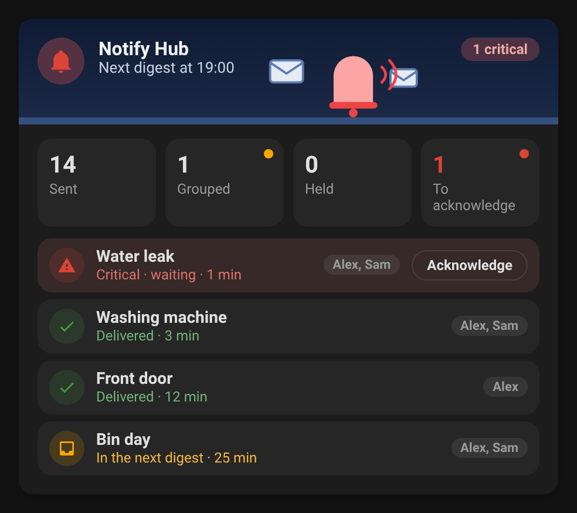 |

### Panel

| Tab | Light | Dark |
|---|---|---|
| Journal |  | 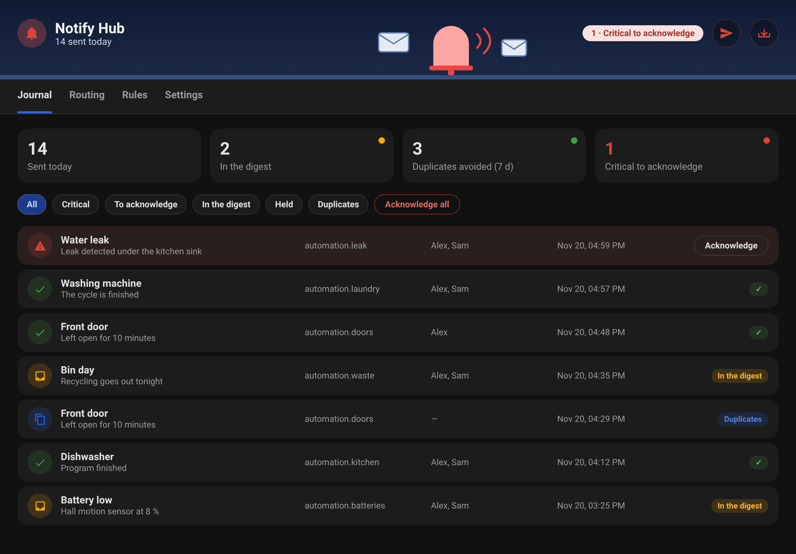 |
| Routing | 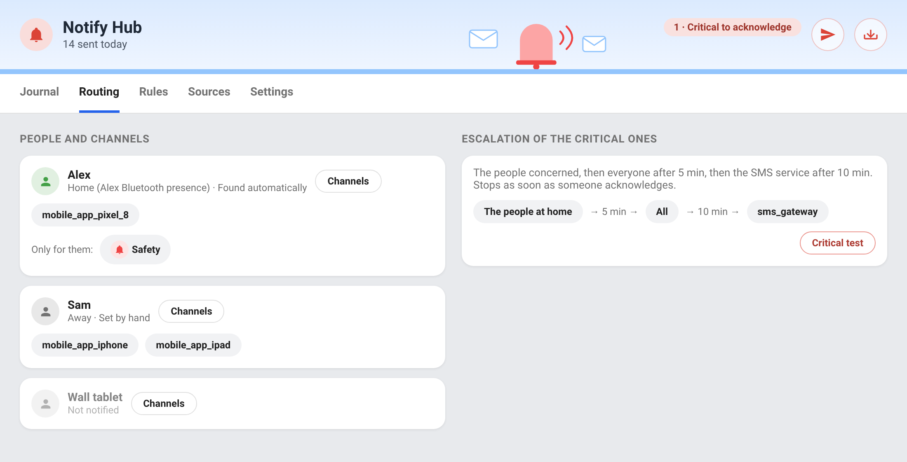 | 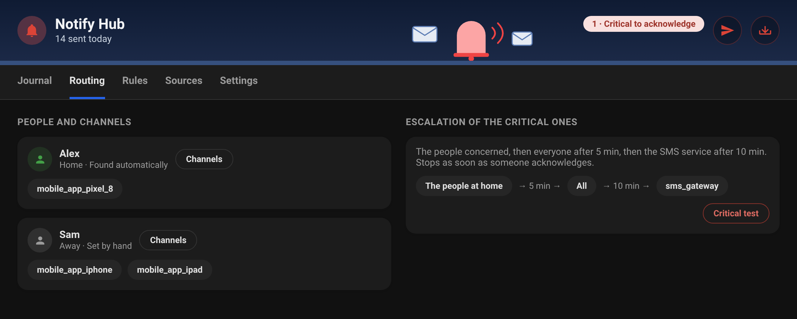 |
| Rules | 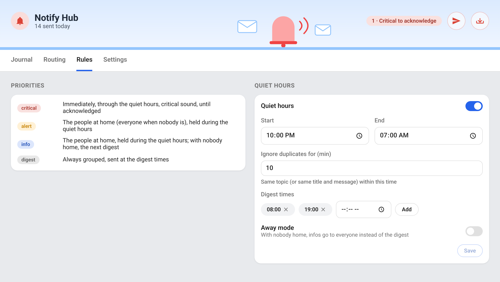 | 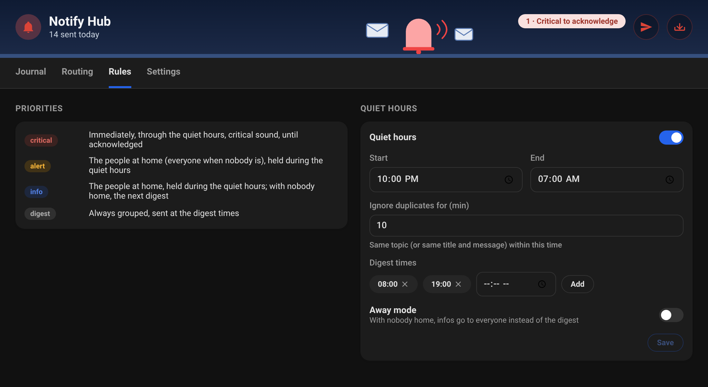 |
| Sources | 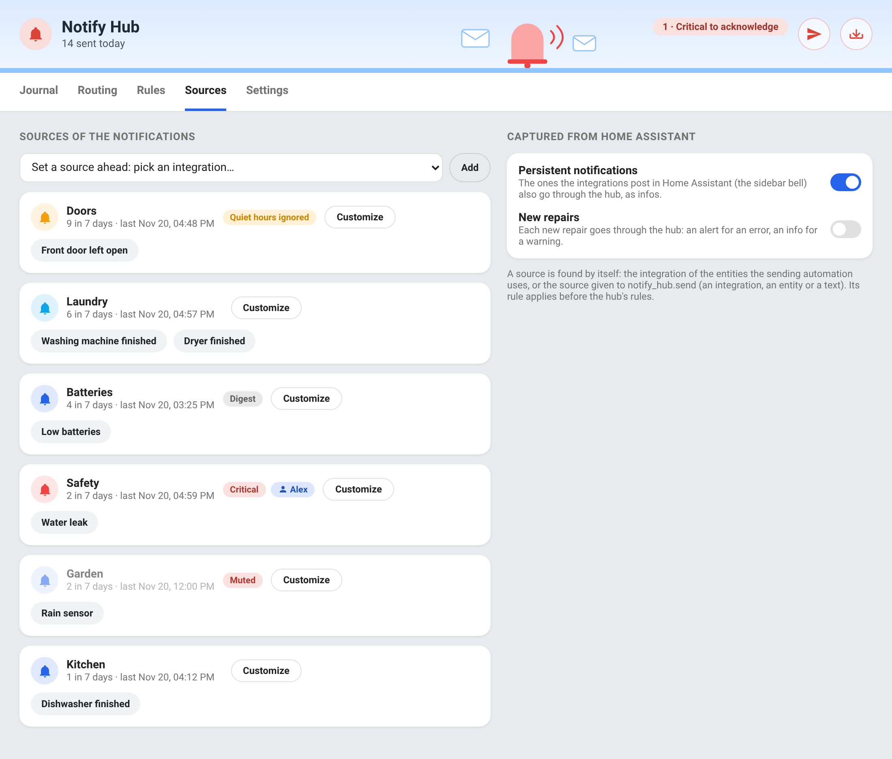 | 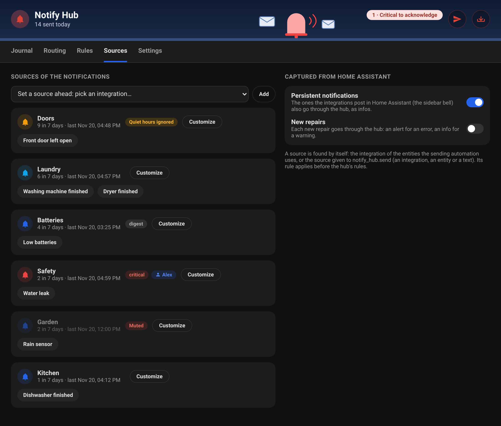 |
| Settings | 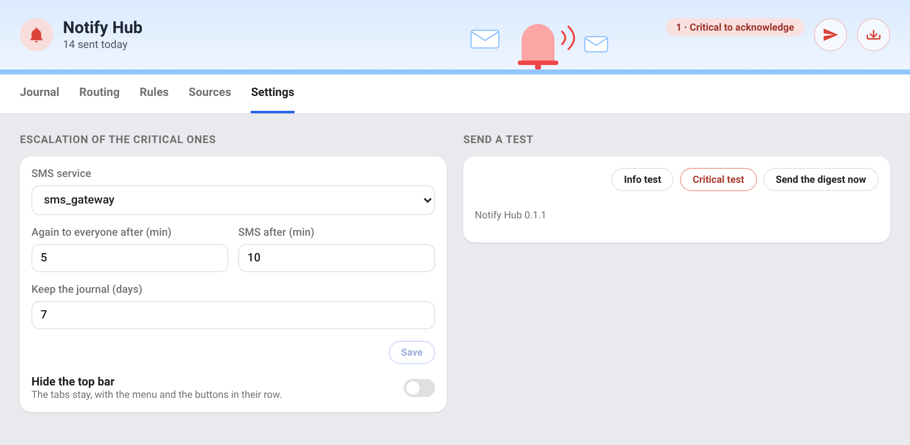 | 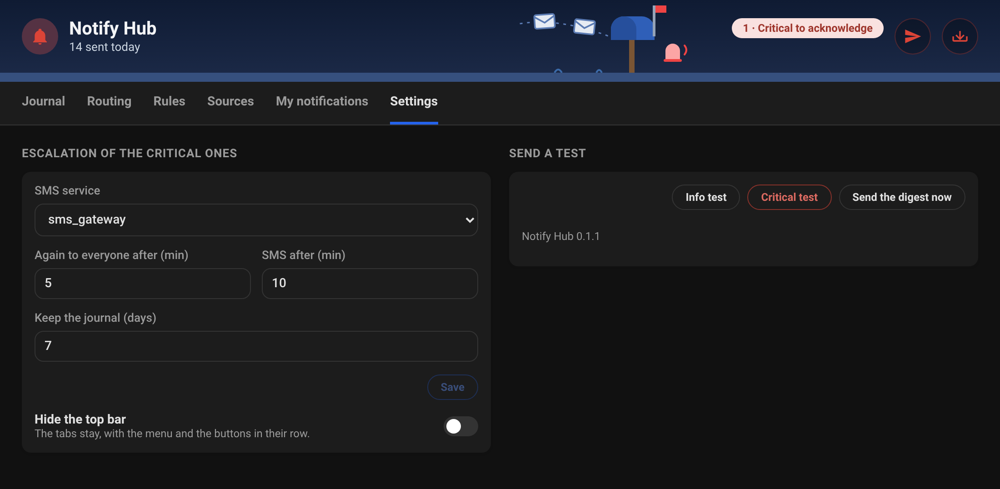 |

## How it works

1. An automation calls `notify_hub.send`.
2. A duplicate of a recent notification (same topic, or same title and message, within the duplicate window) is journaled and dropped.
3. The people concerned are worked out (those asked, else everyone; for `alert` and `info`, only those at home when someone is).
4. `digest` always waits for the next digest time, and so does `info` when nobody is home (unless the away mode is on); during the quiet hours, `alert` and `info` are held.
5. Otherwise it goes to each person's phones. A `critical` notification carries an Acknowledge button and starts the escalation.
6. Every 30 seconds, the hub releases what the quiet hours held, sends the digests that are due, escalates and prunes the journal.

## Development

```bash
pip install -r requirements_test.txt && pytest
npm install --no-save acorn@8.19.0 && node scripts/split-frontend.mjs --check   # the translation split the release makes
pip install playwright pillow && playwright install chromium
python scripts/screenshots.py    # renders the stills and the GIF (needs ffmpeg) into screenshots/
python scripts/layout_check.py   # the card and the panel patch their DOM in place on state updates
```

### Releasing

1. Bump the version in `custom_components/notify_hub/manifest.json`, `const.py` (`VERSION`) and the version constants of `frontend/notify-hub-panel.js` and `frontend/notify-hub-card.js` (the **Version consistency** check compares them)
2. Add a `## <version>` section at the top of [CHANGELOG.md](https://github.com/juju35/ha-notify-hub/blob/main/CHANGELOG.md)
3. Push to `main`: the **Release** workflow creates the tag and the GitHub release with the changelog section as notes

## Translations

The integration, the panel and the card follow the language of Home Assistant (the card's `language` option can force another one). In the release, the card file keeps English only; each other language is a small file next to it, loaded when needed. Currently supported:

| Language | Code |
|---|---|
| English | `en` |
| Français | `fr` |
| Deutsch | `de` |
| Español | `es` |
| Српски | `sr` |
| Srpski (latinica) | `sr-Latn` |
| Italiano | `it` |
| Nederlands | `nl` |
| Português (Portugal) | `pt` |
| Polski | `pl` |
| Română | `ro` |
| Dansk | `da` |
| Svenska | `sv` |
| Български | `bg` |
| Русский | `ru` |
| Українська | `uk` |
| Magyar | `hu` |
| Slovenčina | `sk` |
| Čeština | `cs` |
| Slovenščina | `sl` |
| Latviešu | `lv` |
| Ελληνικά | `el` |

Brazilian Portuguese (`pt-BR`): pt-BR uses the European Portuguese texts.

Contributions for additional languages are welcome!

## License

[MIT](https://github.com/juju35/ha-notify-hub/blob/main/LICENSE)

## Support

If you find this project useful, you can support its development:

<a href="https://buymeacoffee.com/julienstep9"></a>
